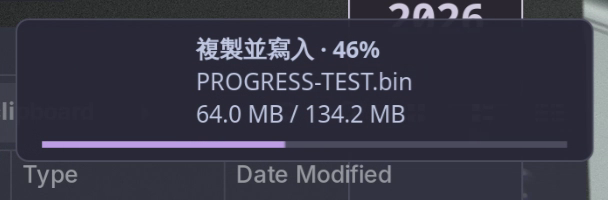

## My Linux Rice
QWQ
### Device Information

- Device: Lenovo ThinkBook 16 G7+ IAH (21TL)
- CPU: Intel Core Ultra 9 285Z
- GPU: NVIDIA GeForce RTX 5060 
- RAM: 32 GB
- STORAGE: 1TB NVMe SSD (ZhiTai Ti7100)
- Display: 3200x2000 @ 60Hz (MNG007ZA1-4)

---

### System Environment

- OS: Garuda Linux (x86_64, Arch-based)
- Kernel: Linux 6.18.7-zen1-1-zen
- Window Manager: Niri 25.11 (Wayland)
- Shell: Bash 5.3.9
- Terminal: Kitty 0.45.0
- Font: JetBrains Mono Nerd Font (12pt)

---

### Rice Setup

- Bar: Waybar
- Launcher: Wofi
- Input Method: Fcitx5
- Notifications: Mako
- Music Visualizer: Cava
- Theme: Catppuccin-Mokka
- Input Method: Fcitx5 + Rime

---

### Credits and References

This configuration is inspired by and based on the following projects:

- Niri Window Manager  
  https://github.com/YaLTeR/niri

- Garuda Linux  
  https://garudalinux.org

- Waybar  
  https://github.com/Alexays/Waybar

- Fcitx5  
  https://github.com/fcitx/fcitx5

- Catppuccin  
  https://github.com/catppuccin/catppuccin

- Others Dotfiles I Took Inspiration From
  
  https://github.com/diinki/diinki-retrofuture (really help)
  
  https://github.com/SHORiN-KiWATA/Shorin-ArchLinux-Guide

...

---

### Screenshots

Screenshots can be found in the `screenshots/` directory.


---

### Nemo → Mako Copy Progress

Copy progress notifications for Nemo on Niri / Wayland.

- Progress: a thin lavender bar, percentage and file name in Mako.
- Usage: the usual Ctrl+C / Ctrl+V, with the original Nemo interface.
- SD cards: progress follows confirmed writes, then shows completion after syncing.
- Scope: the percentage is for the current file; Nemo keeps its own overall progress.
- Verified: a 1.06 GB copy with matching readback hashes, plus actual keyboard copy / paste.



[Recording](nemo-mako-progress/assets/progress.mp4) · [Details and maintenance](nemo-mako-progress/README.md)

Build and install from the repository root:

```sh
cd nemo-mako-progress
sh build.sh
sh test.sh
python install.py
```

Restart Nemo after installation. The module uses the installed C compiler and
GTK 3 / GLib development headers; the tests also need Python GObject bindings,
D-Bus and a running Wayland session. The installer backs up existing user files.

The existing Mako and GTK 3 dotfiles have also been updated. No new desktop
configuration files were added. Other configs and the earlier screenshots are
kept as they were.

Frequent synchronization can make removable-drive copies a little slower.
Use Eject before unplugging a device, even after the copy is finished.
