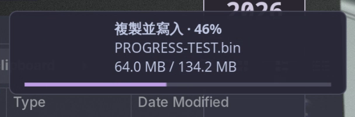

# Nemo → Mako copy progress

Adds a thin lavender progress bar and a percentage to Mako while using the
original Nemo on Niri/Wayland. Normal Copy/Paste operations use the bridge;
Nemo's executable, theme, scaling and display backend stay unchanged.



[Actual copy recording](assets/progress.mp4)

## How it works

`~/.local/bin/nemo` loads `libnemo-progress.so` as both a GTK module and an
`LD_PRELOAD` library, then executes `/usr/bin/nemo`. The GTK module starts the
notification UI only in Nemo. The bridge wraps the public `g_file_copy()` API;
GIO still implements copying, overwriting, permissions, metadata and cancellation.
No private Nemo structs, GTK widget scraping, file scanner or background daemon
is involved.

For a removable Linux block device, the bridge bounds `copy_file_range()`,
`splice()` and `write()` chunks and calls `fdatasync()` at 1 MiB checkpoints.
Only confirmed bytes advance the removable-device percentage. This solves the
case where an entire SD-card copy first enters the cache and reports no useful
intermediate progress. Synchronizing frequently can reduce write throughput;
the tradeoff is explicit, bounded writeback and useful progress.

Before reporting a successful local copy, the worker calls `fsync()` on the
finished destination and its parent directory. Flush errors are returned to
Nemo as copy errors. It does not run a system-wide `sync()` or retain a mount
file descriptor after the copy. On internal storage, GIO's fast reflink copying
is preserved; the last stage can display “確認寫入” while the final flush waits.
Remote destinations retain their backend's guarantees and receive a neutral
completion caption.

The GTK thread updates a single desktop notification, with at most one D-Bus
request in flight. A 33 ms timer eases the bar toward confirmed progress with
subpixel steps; it never invents progress beyond the measured count. The thin
bar uses the standard raw `image-data` hint, so no SVG files or image-loader
processes are needed. Completion reaches 100% only after a successful flush.

Notifications use **only `replaces_id`**, without `x-dunst-stack-tag`.
Mako 1.11.0 has a use-after-free when both refer to the same notification;
this was the initial implementation's crash. The saved local coredump and an
isolated reproduction matched [upstream issue #653](https://github.com/emersion/mako/issues/653).

## Scope and limits

- The percentage is for the **named regular file**, not the sum of an entire
  folder. It starts again for the next file. With concurrent copies, the oldest
  active file is shown, then the next one. Nemo retains its own overall progress.
- Directory setup, symbolic-link copies and same-filesystem moves retain Nemo's
  normal behavior. They do not get an artificial file-copy percentage.
- Checkpoint mode is detected using the destination's Linux sysfs `removable`
  flag. USB SSDs reporting `removable=0` use the ordinary copy/final-flush path.
- An error, skipped file or cancellation is not converted into a successful
  folder-copy result. Nemo's own dialogs remain authoritative.
- Filesystem synchronization is not a checksum or a promise about faulty
  hardware. **Use Eject before unplugging a device.**
- The pre-existing GTK busy-device dialog crash on Wayland is separate. Avoid
  leaving a terminal's working directory inside the card when ejecting. This
  project does not patch GTK or force XWayland.
- This is a Linux/GIO interposition module, verified with Nemo 6.6.4, GLib 2.90.1,
  GTK 3.24.52 and Mako 1.11.0. Recheck after major GIO/Nemo changes.

## Build, install and test

Uses the installed C compiler and GTK 3 / GLib / GIO / GModule development
headers. The test runner additionally uses Python GObject bindings, D-Bus and
the running Wayland display. No extra runtime package is required.

From the root of the Arch-Rice checkout:

```sh
cd nemo-mako-progress
sh build.sh
sh test.sh
python install.py
```

The installer backs up existing files with UTC timestamps and atomically
replaces the module, so it does not truncate an inode mapped by running Nemo.
Restart Nemo after installation. Close active file operations first; remember
open locations before `nemo --quit`, then reopen them with `nemo PATH`.

`sh test.sh` uses a separate session bus and runtime directory. It verifies
real copy contents, overwrite/existing-file handling, cancellation, symlinks,
cross-device moves and injected disk synchronization errors. GLib criticals
fail the test. An in-memory D-Bus receiver checks the module's message format
and completion/error outcomes; it does not create desktop notifications.
The test runner never starts Mako or uses the real desktop's notification bus.
The notification stress generator, test Mako configuration and crash-reproduction
option have been removed.

## Files and maintenance

- `copy-bridge.c`: public GIO copy wrapper, removable-device detection, checkpoint
  writes and final synchronization; cancellation/error behavior stays in GIO.
- `nemo-progress.c`, `progress.h`: thread-safe transfer state and Mako rendering.
- `build.sh`, `install.py`: build and per-user installation.
- `test-copy.c`, `test-sync-error.c`, `test-runner.py`, `test.sh`: verification.
- `assets/`: the cropped screenshot and recording from real Nemo.
- `build/evidence/`: local verification logs and full desktop screenshots; ignored by Git.

Installed files:

- `~/.local/lib/nemo-progress/libnemo-progress.so`
- `~/.local/bin/nemo`
- `~/.local/share/applications/nemo.desktop`
- `~/.local/share/dbus-1/services/nemo.service` and `nemo.FileManager1.service`
- The marked `BEGIN/END nemo-progress` style section of `~/.config/mako/config`

Use `NEMO_PROGRESS_DEBUG=1 ~/.local/bin/nemo PATH` when starting a fresh Nemo
process to log confirmed bytes, displayed fractions and transfer outcomes.
Check `pgrep -a -x mako` and the D-Bus notification owner as well as systemd:
Niri may launch Mako directly, in which case `mako.service` can be inactive even
while Mako is running normally.

To bypass the module temporarily, close Nemo, then start `/usr/bin/nemo`
directly from a shell without `GTK_MODULES`/`LD_PRELOAD` pointing at this module.
To remove it, remove the installed wrapper and this project's desktop/service
overrides (restore a pre-existing custom override from its backup if applicable),
remove the marked Mako style section, reload Mako and restart stock Nemo.
Legacy `bars/` SVG assets from the initial version are unused and may be removed.

## Verified on 2026-11-10 (America/New_York)

A real 1,060,230,584-byte `BODYDATA.DAT` copy through Nemo to an exFAT
SD card progressed from 0% through 99%, then confirmed synchronization and
completed in about 92 seconds. Local screenshots were captured at 15%, 45%, 75% and
completion; only the cropped notification preview and recording are published.
An `O_DIRECT` readback SHA-256 matched the original:

`a8775ce13a66881b93374f06d5f66331c0179c4c71a165dc894641bfdc4d2f05`

The SD card's pre-existing firmware and photos were not overwritten by this
test; a separate temporary test directory was used.

The final module was also verified with actual Ctrl+A / Ctrl+C / Ctrl+V in
native Wayland Nemo, copying a 128 MiB sample to the SD card in about 12 seconds.
There were 358 monotonic notification updates; the maximum observed display
step was 0.568 percentage points. A 30 fps recording is available as
`assets/progress.mp4`, with a cropped preview in
`assets/progress.png`. The sample's direct readback hash also matched.
All temporary test files on the card were removed and the card was successfully
unmounted. The local `build/evidence/verification.json` records versions,
durations, hashes and notification checks; it is not included in the repository.
